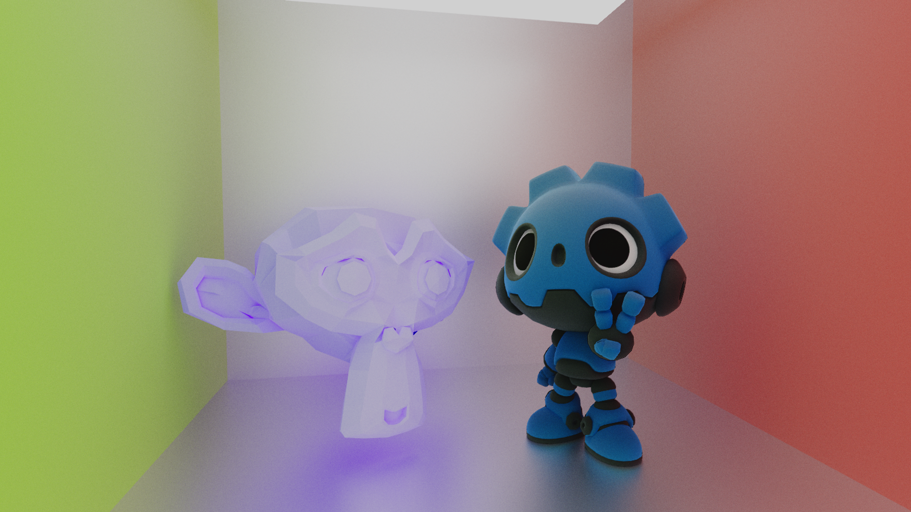

# Godot Pathtracing Plugin




This project aims to add a basic Pathtracer to godot using compute shaders. It's primarily intended for educational and experimental purposes.

## Features

- **Path tracer:** runs as a `CompositorEffect` on Godot's main RenderingDevice and writes HDR radiance straight into the scene color buffer, so Godot's tonemapper, exposure and glow apply as usual.
- **Hardware and software tracing:** uses the GPU's ray tracing cores through Godot 4.7's ray tracing pipeline when available, and falls back to a software BVH in a compute shader otherwise. Both produce the same image.
- **Scene loading:** every `MeshInstance3D` below a `GeometryGroup3D` is rendered by a `PathTracingCamera`. Transforms and visibility are tracked every frame, so objects can move.
- **Lighting:** next event estimation with multiple importance sampling for emissive materials (including emission textures) and an importance-sampled HDR environment map, plus `DirectionalLight3D`, `OmniLight3D` and `SpotLight3D` with soft shadows.
- **Materials:** `StandardMaterial3D`/`ORMMaterial3D` are converted automatically: albedo, roughness and metallic (values and textures), normal maps, emission color and texture, and alpha (scissor as a cutout; blend, hash and depth prepass as stochastic transparency).
- **Temporal accumulation:** samples are reprojected across frames when the camera or objects move, and accumulate without limit when everything is still. Debug views show normals, albedo and BVH traversal cost.
- **ReSTIR GI and DI:** indirect light and direct light from emitters and the environment are resampled across frames and neighbouring pixels, with spatial neighbours picked by the compatibility-guided selection of Junkins et al. 2026.
- **Denoising:** an edge-aware spatial filter (SVGF-style, with albedo demodulation) cleans up the image while things move; static views still converge to the exact result.
- **Portals:** `Portal3D` nodes link two rectangles in space; rays (and the demo camera) pass through, including recursive views of the same room.
- **Editor preview:** tick `editor_preview` on the camera to path trace the editor's 3D viewport.

Requires **Godot 4.7** and the Forward+ renderer.

## Getting Started

### Building

```bash
git submodule update --init
scons target=template_debug -j16
```

`api_version` defaults to 4.7 (godot-cpp 10). Binaries go to `demo/addons/jar_path_tracing/bin/`.

### Usage

1. Put your scene's meshes and lights under a `GeometryGroup3D` node.
2. Use a `PathTracingCamera` (a `Camera3D`) and point its `geometry_group` at the group.
3. Run the scene, or tick the camera's `editor_preview` to see it in the editor. See `demo/demo/demo.tscn`, `demo/demo/lights_demo.tscn`, `demo/demo/portal_demo.tscn` and `demo/demo/bistro_demo.tscn` (needs the Bistro download, see [demo/bistro/README.md](demo/bistro/README.md)).

Disable TAA/FSR on the viewport. To change meshes or materials at runtime, call `GeometryGroup3D.build()`; moving and hiding instances needs nothing.

Implementation notes, measurements, limitations and the roadmap (a portal puzzle game, NEE through portals) are in [docs/NOTES.md](docs/NOTES.md).

## Contributing

Contributions are welcome! Please fork the repository and submit a pull request.

## License

This project is licensed under the MIT License - see the [LICENSE](LICENSE) file for details.

## Acknowledgments

- Special thanks to the Godot community for their support and resources.
